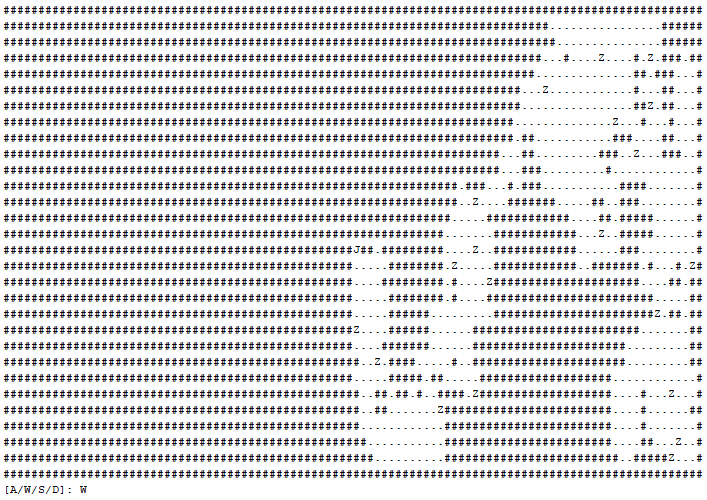

# Roguelike Java

[](https://adoptium.net/temurin/releases/?version=21)
[](https://maven.apache.org/)
[](https://junit.org/)
[](https://github.com/kleberandrade/roguelike-java/actions/workflows/ci.yml)
[](LICENSE)

A turn-based ASCII survival roguelike originally developed by Kléber de Oliveira Andrade for an Object-Oriented Programming course. Explore a procedurally carved cave and avoid wandering zombies. This modernization keeps the Portuguese game interface, original symbols and survival rules, with a portable build, deterministic replays and automated tests.



*Historical screenshot from the original classroom project.*

## Requirements

- A JDK 21 distribution, such as Eclipse Temurin, with `java` on `PATH` and `JAVA_HOME` pointing to the JDK.
- Internet access on the first build to download the pinned Maven distribution and test/build dependencies.
- A terminal at least 100 columns wide for the default map. Narrow terminals wrap the output.
- Python 3 only for the optional packaged application smoke checks.

No Maven installation, NetBeans installation or runtime libraries are required. Java 21 is the supported build and execution baseline. The wrapper pins Maven 3.9.16 and checks its distribution SHA-256.

## Quick start

```sh
git clone https://github.com/kleberandrade/roguelike-java.git
cd roguelike-java
./mvnw --batch-mode --no-transfer-progress clean verify
java -jar target/roguelike-java-1.0.0.jar
```

On Windows, run `./mvnw.cmd --batch-mode --no-transfer-progress clean verify` from PowerShell, followed by the same `java -jar` command. IDE users can open the root `pom.xml` as a Maven project and select JDK 21.

## Controls and rules

Enter one command per line, then press **Enter**. Commands ignore case and surrounding whitespace.

- `W`: up; `A`: left; `S`: down; `D`: right.
- `Q`: end the session without taking another turn. End-of-input also exits cleanly.
- An empty line or an unknown command waits for one turn.
- `J` is the player, `Z` a zombie, `#` a wall and `.` walkable floor.

The default world is 100 × 30 cells, carved by a 2,000-step random walk starting at the center. You begin with three lives and 20 zombies. Walls and map boundaries block movement. Even a blocked movement consumes a turn.

Each turn moves the player first. Every zombie then independently waits or attempts one cardinal move, with equal probability. A zombie sharing the player's cell **after its move** deals one damage. Zombies can overlap each other and the starting position; several zombies on one cell each deal damage. The player symbol takes display priority. You can escape a shared cell before the zombies act.

The game ends in defeat when lives reach zero (`Fim de jogo!`). There is **no win condition**, combat, score goal or finite campaign: the original game is an endless survival exercise. Quitting is not a victory.

## Reproducible examples

Choose a signed 64-bit seed to replay the same map, spawns and zombie turns with the same commands and game version:

```sh
java -jar target/roguelike-java-1.0.0.jar --seed 42
java -jar target/roguelike-java-1.0.0.jar --seed 42 < examples/replay.txt
java -jar target/roguelike-java-1.0.0.jar --help
```

PowerShell replay:

```powershell
Get-Content examples/replay.txt | java -jar target/roguelike-java-1.0.0.jar --seed 42
```

The [small arena example](examples/SurvivalExample.java) demonstrates the domain API and deterministic defeat in three turns. Run it after building, using Java's source launcher:

```sh
java --class-path target/classes examples/SurvivalExample.java
```

The executable JAR keeps `br.unisal.aula.Main` as its entry point. Invalid CLI arguments print usage and exit with status 2; normal quit, EOF and defeat exit with status 0.

## Tests and build

```sh
./mvnw --batch-mode --no-transfer-progress test
./mvnw --batch-mode --no-transfer-progress clean verify
python3 scripts/smoke.py
```

Use `./mvnw.cmd` and `python` on Windows. Tests exercise movement, wall/boundary collisions, zombie directions, turn order, overlapping damage, death, seeded maps and spawns, floor connectivity across 30 seeds, generation errors, rendering, EOF, quit and CLI validation.

`verify` creates JUnit reports in `target/surefire-reports/` and a measured JaCoCo report at `target/site/jacoco/index.html`. No coverage percentage or passing status is hardcoded in badges.

The [CI workflow](.github/workflows/ci.yml) runs the build, packaged JAR smoke checks and source example on Linux and Windows with Temurin 21. Its badge reports GitHub's actual status; it will become available once this workflow is pushed. CI has not been run remotely as part of the local modernization. Dependabot checks Maven and Actions updates monthly.

## Code layout and API

- `src/main/java/br/unisal/aula/`: `Main` CLI and `Jogo` application composition.
- `domain/`: entities, player, zombies, coordinates and turn/collision rules. No console I/O.
- `generation/`: `MundoBuilder`, a connected random-walk map generator with injectable `RandomGenerator`.
- `io/`: line-based console input and ASCII rendering.
- `src/test/java/`: deterministic JUnit behavior tests.
- `examples/`: replay input and a runnable domain example.
- `scripts/`: packaged application checks.
- `docs/`: migration notes and the modernization/validation log.

Build a custom arena with `MundoBuilder`, attach a `Jogador` using `setJogador`, then call `Mundo.atualizar(command)` to advance one turn. The builder requires dimensions of at least 3 × 3, `preencher` before carving/building, an interior walk origin and nonnegative walk/spawn counts. Requesting zombies without any floor throws immediately. Spawns sample floor cells with replacement, so a tiny arena remains valid. Direct `Mundo` construction expects a nonempty rectangular grid; use the builder for normal game creation. See the runnable example for concrete imports and setup.

## Migration and limitations

See [migration notes](docs/migration.md) for the NetBeans-to-Maven transition and source/package changes, and [the modernization log](docs/modernization-log.md) for validation evidence and tool limitations.

The console redraws by printing another map; it does not clear the terminal, use colors or provide a HUD. There is no save/load system or real-time input. Historical ideas for sheep, wolves, treasures, keys, portals, levels and progressive difficulty remain unimplemented classroom challenges. Seed compatibility is limited to the same game implementation; old unseeded sessions cannot be replayed.

## License

[MIT](LICENSE), copyright 2019 Kléber de Oliveira Andrade. The original license and screenshot are preserved. Generated Maven Wrapper scripts retain their Apache Software Foundation notices; see [third-party notices](docs/third-party-notices.md).
